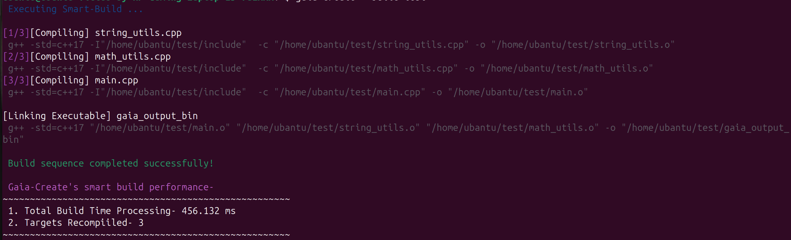

# Gaia-Create

A lightweight incremental build tool and offline code integrity guard written in C++17.

## Problem
Standard build tools can be complex for small projects, while manual compilation is inefficient and often recompiles unchanged files, wasting computing resources.

## Solution
Gaia-Create is a smart incremental build tool that tracks file modifications to recompile only modified source files. It includes a static analyzer using local LLMs to detect structural patterns in code and suggest changes.

## Features
- [x] **Incremental Build Engine:** Tracks file dependencies via a Directed Acyclic Graph (DAG) and 3-state DFS cycle detection.
- [x] **Multi-Threaded Compilation:** Distributes compilation tasks across CPU cores using `std::async` and `std::future` with thread-safe logging.
- [x] **Block-Based Content Hashing:** Replaces flaky timestamps with true byte-stream hashing and a local `.gaia_cache` ledger to prevent redundant builds.
- [x] **Local AI Integration:** Interfaces via raw TCP/POSIX sockets with Ollama (Llama 3.2 1B) for offline static analysis and pattern recognition.
- [x] **JSON Compilation Database:** Generates standard `compile_commands.json` compilation databases for IDE tooling (Clangd, VS Code, Neovim).
- [x] **Cross-Platform Support:** Preprocessor-guarded `#ifdef _WIN32` abstraction layer supporting Linux POSIX sockets and Windows Winsock.

## Algorithms - Complexity

 Dependency Graph Construction - O(V + E)

 DFS Cycle Detection - O(V + E)

 Incremental Scan - O(n)

 Directory Traversal - O(files)

## Comparison

| Feature | Make | CMake | Gaia-Create |
| :--- | :---: | :---: | :---: |
| Configuration | Complex | Complex | None |
| Incremental Build | Yes[cite: 4] | Yes | Yes |
| Dependency Graph | Partial | Yes | Yes |
| Local AI Review | No | No | Yes |

## Installation

1. Install dependencies:
- sudo apt update && sudo apt install build-essential curl python3

2. Compile the tool:
- make

3. Install globally (creates a system-wide symbolic link):
- sudo rm -rf /usr/local/bin/gaia-create
- sudo ln -s "$(pwd)/gaia-create" /usr/local/bin/gaia-create

4. Setup for other projects:
To use Gaia-Create for any project, simply reference the target directory in the build command. Gaia-Create automatically converts relative paths to absolute paths, ensuring consistent dependency resolution regardless of your current working directory[cite: 4].

5. Verify installation:
- gaia-create --help

## Usage

Build a project:

- gaia-create --build /path/to/your/project

Run AI review:

- gaia-create --review /path/to/your/project

Clean build artifacts:

- gaia-create --clean /path/to/your/project

## Performance Metrics

## Tech Stack
- **Language:** C++17
- **Core Library:** `std::filesystem`
- **Concurrency:** `std::async`, `std::future`, `std::mutex`
- **Algorithms:** DAG, 3-state DFS Topological Sort
- **Networking:** POSIX Sockets / Windows Winsock (`WS2_32`)
- **Build System:** Make
- **AI Backend:** Ollama (Llama 3.2 1B)

## Future Work
-Parallel compilation: Implementing multi-threaded execution for faster builds.(Completed!)   
-JSON compilation database: Improving compatibility with IDEs.(Completed!)  
-Windows support: Porting filesystem and socket logic.(Completed!)
-File hashing: Replacing timestamp checks with content hashing for higher accuracy.(Completed!)

## License
MIT License
